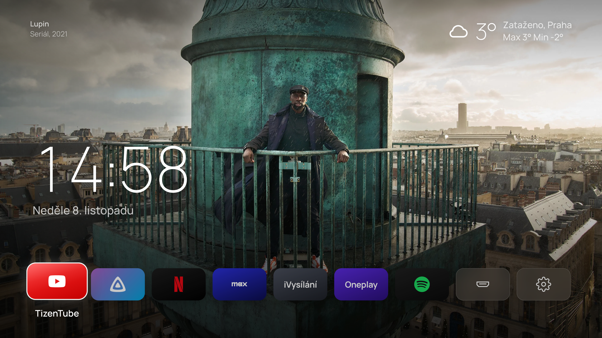
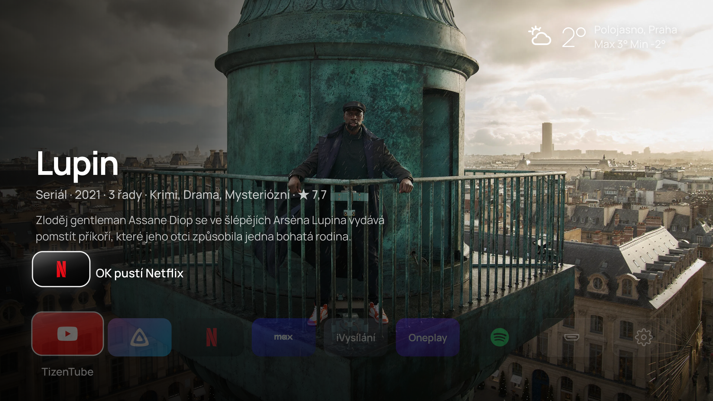
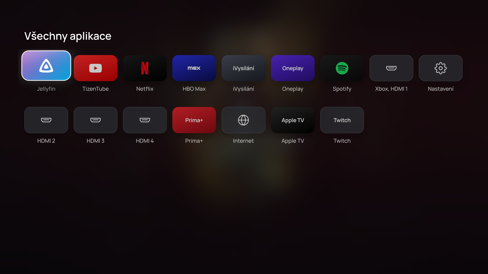
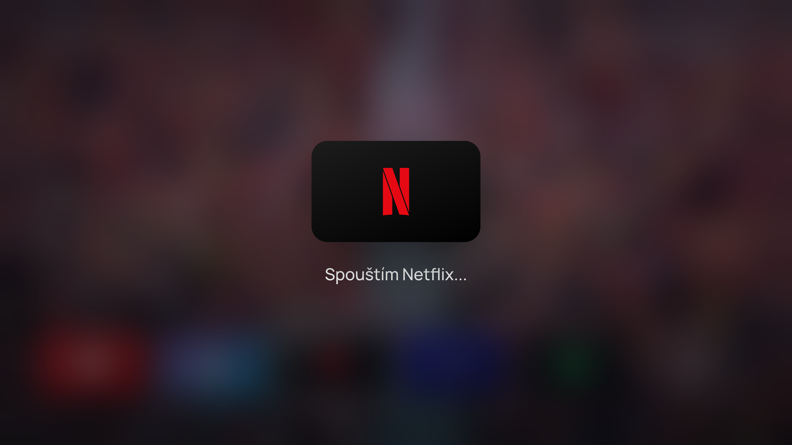
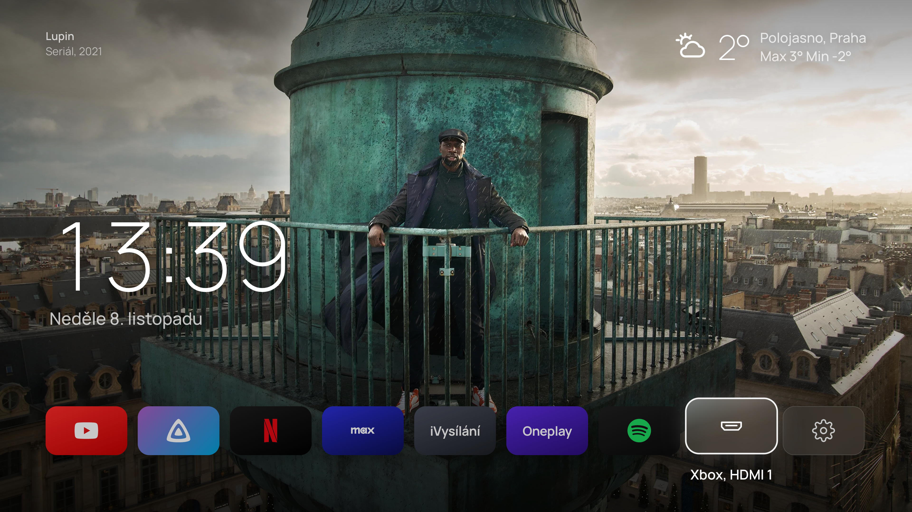
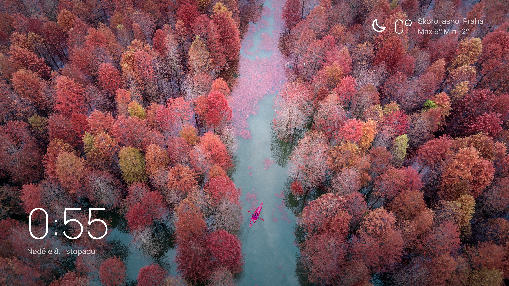
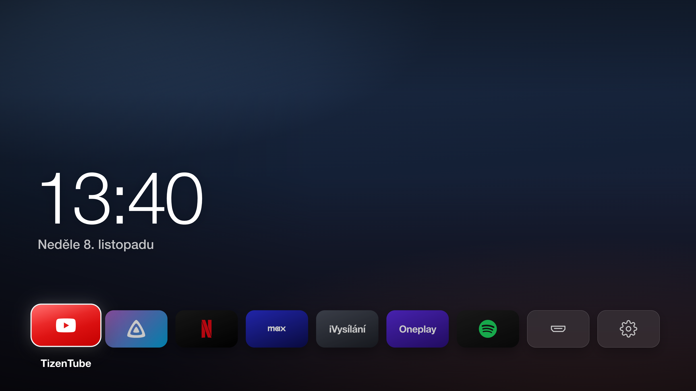

# TV Home

A calm home screen for Samsung TVs, built as a [TizenBrew](https://github.com/reisxd/TizenBrew) module. A full-screen 4K still from a film or series trending this week, the time and date in Czech (Prague time), today's weather, and one row of apps you open with the remote. Up tells you about the film on screen, Down shows every app on the TV.

Made for a 65 inch Samsung OLED (2024, Tizen 8.0) and laid out for 4K: everything is sized relative to the screen width, so it looks the same on a 1080p set, only less sharp.

| Up: what the film is, and OK plays it where it streams | Down: every app, the last one used first |
| --- | --- |
|  |  |

| Opening an app | HDMI 1 for the Xbox and Settings at the end of the row |
| --- | --- |
|  |  |

| Ambient mode after 90 s without input | No internet: only the gradient, nothing broken |
| --- | --- |
|  |  |

TV Home opens from a copy stored on the TV and shows the last film still at once (about 0.1 s in Chrome), then picks up a newer version from GitHub for the next start.

All screenshots are real 3840x2160 captures from Chrome, driven with remote key events, against a stand-in for the TV that lists the apps this TV reports.

## Install on the TV

You need TizenBrew on the TV, with Developer Mode on and its Host PC IP set to `127.0.0.1` (TizenBrew's own requirement).

1. Open TizenBrew and press the GREEN button for the module manager.
2. Choose **Add GitHub Module** and type `ottomansky/tvhome`.
3. Go back to the module list and open **TV Home**.
4. To open it every time TizenBrew starts: Settings, **Autolaunch Settings**, pick TV Home.

To get back to TizenBrew's own menu while autolaunch is on, hold Up on the remote while TizenBrew starts.

## Remote

Left and Right move between apps, OK opens one, Back closes the launch screen.

- **Up** opens the film info: title, year, length, genres, TMDB rating, a short synopsis, whether it is in Czech cinemas or gets a new episode, and where it streams in the Czech Republic. If it streams on an app you have, OK opens that app. Down or Back closes it.
- **Down** opens all apps installed on the TV, the most recently opened first. Arrows move, OK opens, Up from the first row or Back goes back.
- The last two tiles are **HDMI 1** (the Xbox) and **Settings**. HDMI 2, 3 and 4 are the first tiles on the second row under Down, two presses away. They press the TV's own HDMI and Menu keys. The first time, the TV asks whether to allow "TV Home"; press Allow once. After 90 s without input the app row fades out and only the picture and time stay. After 20 minutes the whole screen dims. Any button wakes it, and that first press does nothing else.

## How it works

- `app.html` is the whole home screen: plain HTML, CSS and JavaScript, no build step. `home.html`, the file TizenBrew opens, is a tiny loader that fetches the newest `app.html` from GitHub (at most 5 minutes old), and the copy that came with the module when GitHub is unreachable.
- `service.js` runs inside TizenBrew's background service and does what the page cannot. It starts apps through the TV's own app API (`http://127.0.0.1:8001/api/v2/applications/<id>`, the one the SmartThings app uses) and checks that the app is running, falling back to Tizen's app launcher by ID or name. It presses remote keys through the TV's remote-control channel (port 8002), and lists the installed apps for the Down view.
- Recently used order is kept in the page's local storage on the TV.
- `data/backdrops.json` is the list of backdrops. A GitHub Action (`.github/workflows/backdrops.yml`) refreshes it every morning from TMDB: trending films and series this week, titles in Czech, only backdrops without text on them, 3840 pixels wide where available. The TMDB key lives in the repository's `TMDB_KEY` secret, never in the code.
- Backups: if the list cannot load, Bing photos of the day (via Peapix, no key). If nothing loads, a dark gradient.
- Weather comes from [Open-Meteo](https://open-meteo.com), free and without a key.

## OLED care

Nothing on the screen stays still for hours: every 3 minutes all text and tiles move by a few pixels, the app row disappears after 90 s, and the screen dims after 20 minutes without input. Samsung's own pixel shift and screen saver still apply on top.

## Change the apps

Edit the `APPS` list near the top of the script in `app.html` (nine tiles fit one row): name, colors, logo, and what to open (`tv` for the TV's app ID, `key` for a remote key such as `KEY_HDMI2`). `EXTRA` gives apps that only show under Down a look of their own, `PROVIDERS` maps streaming services from the film data to apps. To check an app ID from a computer on the same network: `curl http://<tv-ip>:8001/api/v2/applications/<id>`.

## Updates

Changes to `app.html` reach the TV within about 5 minutes: restart TizenBrew, or open TV Home again. TizenBrew itself loads `home.html`, `package.json` and `service.js` through jsDelivr, which caches GitHub files for up to 12 hours and ignores purges at some of its servers, so changes to those three files are slow. To get one onto the TV at once, add the module pinned to a commit, `ottomansky/tvhome@<commit>`, which jsDelivr serves fresh. Do not add git tags: with a tag, jsDelivr serves the newest tag instead of `main`. The backdrop list is read straight from GitHub and is fresh every morning.

## Tests

`npm test` runs `service.js` the way TizenBrew does, against a fake TV app API and a fake Tizen launcher, and checks which apps it starts, the fallbacks, the app list filter and that errors never stop the service. `node test/service.test.js --serve` keeps that fake TV running, so `app.html` can be tried in a browser.

## Credits

This product uses the TMDB API but is not endorsed or certified by TMDB. Film images belong to their owners. App logos from [Simple Icons](https://simpleicons.org) (CC0), brand marks belong to their owners and are used here for a personal launcher only. Font: Manrope (SIL Open Font License).

## License

MIT
