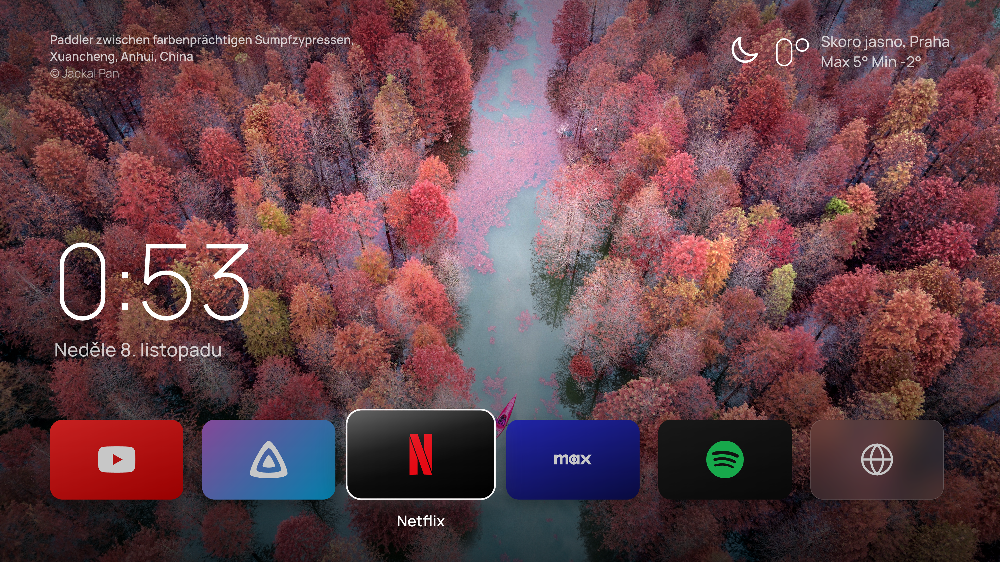

# TV Home

A calm home screen for Samsung TVs, built as a [TizenBrew](https://github.com/reisxd/TizenBrew) module. A full-screen 4K still from a film or series trending this week, the time and date in Czech (Prague time), today's weather, and one row of apps you open with the remote.

Made for a 65 inch Samsung OLED (2024, Tizen 8.0) and laid out for 4K: everything is sized relative to the screen width, so it looks the same on a 1080p set, only less sharp.

| Focus moved two tiles right | Opening an app |
| --- | --- |
|  |  |

| Ambient mode after 90 s without input | No internet: only the gradient, nothing broken |
| --- | --- |
|  |  |

All screenshots are real 3840x2160 captures from Chrome. Until the TMDB list is generated, the page uses its backup photos (Bing photo of the day), which is what these show.

## Install on the TV

You need TizenBrew on the TV, with Developer Mode on and its Host PC IP set to `127.0.0.1` (TizenBrew's own requirement).

1. Open TizenBrew and press the GREEN button for the module manager.
2. Choose **Add GitHub Module** and type `ottomansky/tvhome`.
3. Go back to the module list and open **TV Home**.
4. To open it every time TizenBrew starts: Settings, **Autolaunch Settings**, pick TV Home.

To get back to TizenBrew's own menu while autolaunch is on, hold Up on the remote while TizenBrew starts.

## Remote

Left and Right move between apps, OK opens one, Back closes the launch screen. After 90 s without input the app row fades out and only the picture and time stay. After 20 minutes the whole screen dims. Any button wakes it, and that first press does nothing else.

## How it works

- `index.html` is the whole home screen: plain HTML, CSS and JavaScript, no build step.
- `service.js` runs inside TizenBrew's background service. Pages opened by TizenBrew cannot use the TV's app launcher, so the page asks this service on `http://127.0.0.1:8091` to start Netflix, Spotify and the rest. It looks the app up among the apps installed on your TV (by the IDs in `index.html`, then by name), because Samsung app IDs differ between TV years.
- The YouTube tile opens **TizenTube** (YouTube without ads) when that module is in TizenBrew, and the normal YouTube app otherwise. The Jellyfin tile does the same with the `@glenlowland/jellyfin-tizen` module.
- `data/backdrops.json` is the list of backdrops. A GitHub Action (`.github/workflows/backdrops.yml`) refreshes it every morning from TMDB: trending films and series this week, titles in Czech, only backdrops without text on them, 3840 pixels wide where available. The TMDB key lives in the repository's `TMDB_KEY` secret, never in the code.
- Backups: if the list cannot load, Bing photos of the day (via Peapix, no key). If nothing loads, a dark gradient.
- Weather comes from [Open-Meteo](https://open-meteo.com), free and without a key.

## OLED care

Nothing on the screen stays still for hours: every 3 minutes all text and tiles move by a few pixels, the app row disappears after 90 s, and the screen dims after 20 minutes without input. Samsung's own pixel shift and screen saver still apply on top.

## Change the apps

Edit the `APPS` list near the top of the script in `index.html`: name, colors, logo, and what to open (`module`, `ids`, `match`). To see the IDs of the apps on your TV, open `http://127.0.0.1:8091/apps` from any TizenBrew module page, or check the service's answer in the TizenBrew debugger.

## Updates

TizenBrew loads the module through jsDelivr, which caches GitHub files for up to about 12 hours, so a change reaches the TV the next day, or right away after a cache purge at `https://purge.jsdelivr.net/gh/ottomansky/tvhome/index.html` (same for `service.js` and `package.json`). The backdrop list is read straight from GitHub and is fresh every morning.

## Tests

`npm test` runs `service.js` the way TizenBrew does, against a fake TV, and checks which apps it starts.

## Credits

This product uses the TMDB API but is not endorsed or certified by TMDB. Film images belong to their owners. App logos from [Simple Icons](https://simpleicons.org) (CC0), brand marks belong to their owners and are used here for a personal launcher only. Font: Manrope (SIL Open Font License).

## License

MIT
